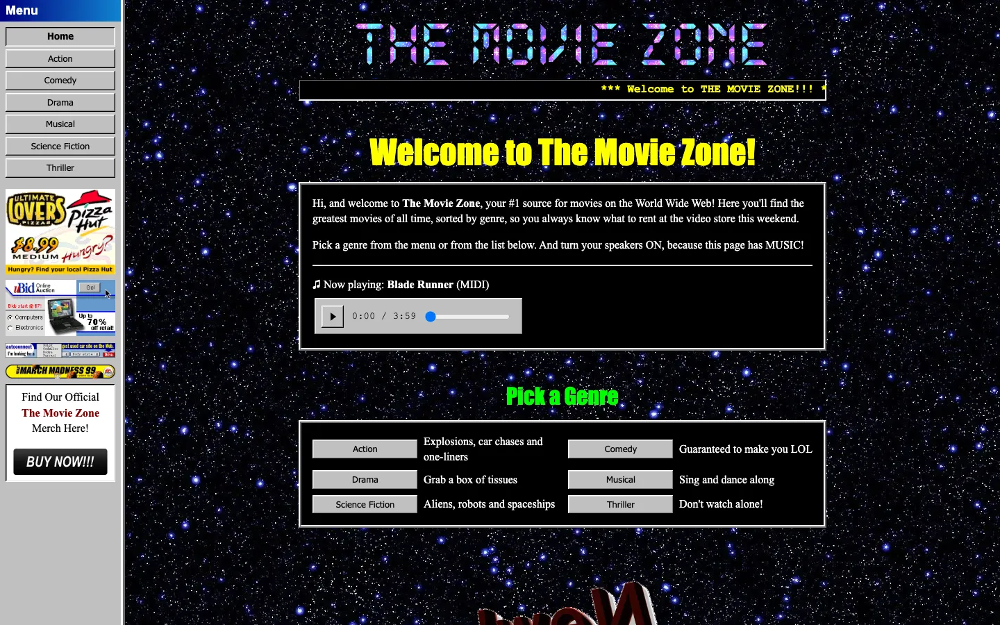
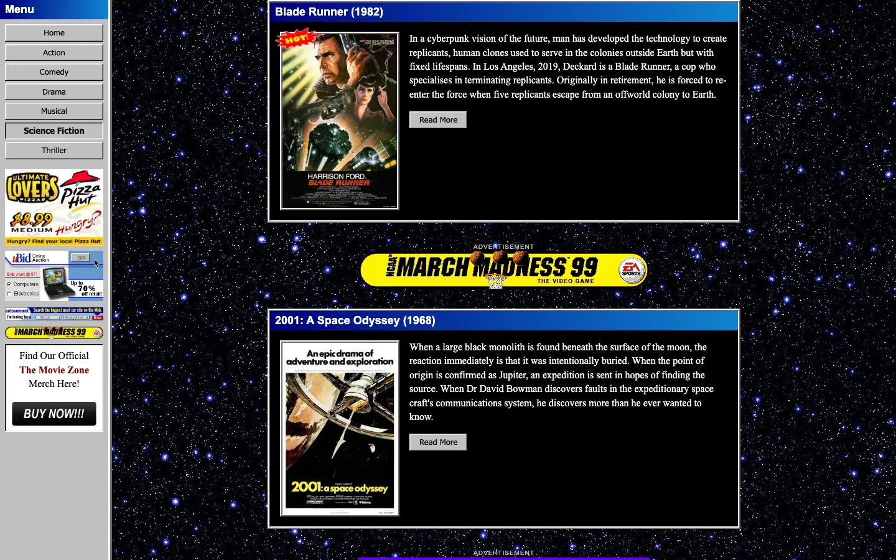
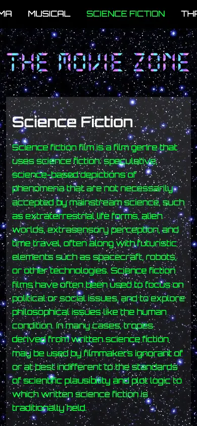

# The Movie Zone

A school project recreating a late-90's movie website: a home page and six genre
pages with frames, blinking GIFs, banner ads, a MIDI soundtrack, a webring and a
visitor counter, built with modern, accessible HTML and CSS underneath.







## How to Run

Serve the folder with any static web server and open `index.html`, e.g.

```sh
npx live-server   # reloads the page when you save a file
# or
python3 -m http.server
```

Then open the URL it prints (<http://localhost:8000> for Python).

Opening `index.html` directly from disk (`file://`) mostly works, but the browser
will block the MIDI player from loading `music/blade-runner.mid`.

## Project Structure

| Path                      | What it is                                                                                   |
| ------------------------- | -------------------------------------------------------------------------------------------- |
| `index.html`              | Entry point. Two iframes, menu and content, like a 90's frameset.                            |
| `nav.html`                | The menu and sidebar ads. Links open in the content frame (`target="main"`).                 |
| `home.html`               | The home page: welcome, music player, genre list, news, webring and visitor counter.         |
| `genre.html`              | One page for every genre, e.g. `genre.html?genre=action`. Filled in by `js/genre-page.js`.   |
| `under-construction.html` | Placeholder for every page that doesn't exist yet.                                           |
| `css/tokens.css`          | Design tokens: every color, font and size (see Design).                                      |
| `css/styles.css`          | All styles, for every page. Uses only the tokens.                                            |
| `js/genres.js`            | Content of the genre pages: intro, Top 3 movies and the banner ads.                          |
| `js/genre-page.js`        | Renders `genre.html` from `js/genres.js` using the `<template>`s in genre.html.              |
| `js/nav.js`               | Highlights the menu item for the page shown in the content frame.                            |
| `js/quiet-audio.js`       | Silences the info logs from the MIDI player's libraries.                                     |
| `vendor/`                 | Third-party JavaScript (see Dependencies), each with its license.                            |
| `images/`                 | Images and GIFs. `images/posters/` has the movie posters, `images/still/` non-animated GIFs. |
| `music/`                  | MIDI files for the player.                                                                   |
| `favicon.svg`             | Pixel-art favicon.                                                                           |

## Features

- Frame layout with a menu and content frame
- Home page plus six genres (Action, Comedy, Drama, Musical, Science Fiction,
  Thriller), each with a Top 3 list. All movies are from before 1999, to match
  the site's 1999 setting.
- On phones the menu turns into a horizontally scrolling bar at the top
- MIDI music player
- Animated GIFs, banner ads, "under construction" signs and a visitor counter
  (just for show: it's plain HTML and CSS and always says 000420)
- Marquee and blinking text, done in CSS
- No CSS framework, no web fonts, nothing to build

## Design

The site looks like a fan site from 1999, made with what a webmaster had back
then. Under the hood it's modern, accessible HTML and CSS.

- **GeoCities style:** a tiled star background, Times New Roman, the bright
  named colors of HTML 3.2, black boxes with 3D borders like
  `<table border="4" bgcolor="black">`, grooved `<hr>` lines, a marquee,
  blinking text, a webring, a guestbook and a "Best viewed with Internet
  Explorer" badge.
- **Windows 95/98 interface:** grey 3D buttons, navy title bars, a grey menu
  frame with a visible frame border, and a music player to match.
- **No modern effects:** no rounded corners, drop shadows or transitions. The
  only gradient is the Windows 98 title bar.

### Layout

| Screen              | Layout                                                                                     |
| ------------------- | ------------------------------------------------------------------------------------------ |
| Desktop             | Menu frame (180px) on the left, content frame on the right, like `<frameset cols="180,*">` |
| Content             | Centered and 760px wide, the width that fit an 800x600 screen                              |
| Below 36rem (576px) | Two-column parts (intro, movie cards, genre list) stack into one column                    |
| Below 40rem (640px) | The menu frame moves to the top and becomes a 3.5rem bar of buttons you swipe sideways     |

`nav.html` switches to its one-row layout when its frame is less than 6rem tall,
because media queries inside an iframe measure the iframe, not the screen.
Breakpoints can't be custom properties (`var()` doesn't work in `@media`), so
they are written out in `styles.css`.

### Colors

All colors are named colors from HTML 3.2, plus the Windows 98 title bar blue.

| Role                      | Token                | Color                       |
| ------------------------- | -------------------- | --------------------------- |
| Page background           | `--color-page`       | black `#000000`             |
| Body text                 | `--color-text`       | white `#ffffff`             |
| Footer and small labels   | `--color-text-muted` | silver `#c0c0c0`            |
| Page titles (`h1`)        | `--color-heading-1`  | yellow `#ffff00`            |
| Section titles (`h2`)     | `--color-heading-2`  | lime `#00ff00`              |
| Links / visited / clicked | `--color-link`...    | aqua / fuchsia / red        |
| "Come back later!"        | `--color-alert`      | red `#ff0000`               |
| Buttons, menu, player     | `--color-chrome`     | silver `#c0c0c0`            |
| Title bars                | `--color-titlebar-*` | navy `#000080` to `#1084d0` |

Every text color passes the WCAG AA contrast minimum on its background except
one: white title bar text over the light-blue right end of the gradient is
4.0:1, where AA asks for 4.5:1. Most titles end before that point, but long
titles on narrow screens reach it.

### Typography

Web fonts didn't exist yet, so the site only uses fonts that came with
Windows and Mac OS.

| Use                                | Token            | Font            |
| ---------------------------------- | ---------------- | --------------- |
| Body text                          | `--font-body`    | Times New Roman |
| Headings                           | `--font-heading` | Impact          |
| Title bars, "Advertisement" labels | `--font-label`   | Arial           |
| Buttons and the menu               | `--font-ui`      | Tahoma          |
| "Come back later!"                 | `--font-fun`     | Comic Sans MS   |
| Marquee, counter, player time      | `--font-mono`    | Courier New     |

Font sizes follow the HTML 3.2 `<font size="1">` to `<font size="7">` scale:
10, 13, 16, 18, 24, 32 and 48px (`--font-size-1` to `--font-size-7`).

### Components

| Class                       | What it is                                                                          |
| --------------------------- | ----------------------------------------------------------------------------------- |
| `.panel`                    | Black box with a 3D border, used for most content                                   |
| `.button`                   | Windows 95 button (on links). Pressed in when clicked or when it's the current page |
| `.titlebar`                 | Windows 98 title bar: the menu heading and the movie titles                         |
| `.movie`                    | Movie card: title bar, poster (with an optional "HOT!" badge) and plot              |
| `.ad`                       | Banner ad with a small "Advertisement" label                                        |
| `.marquee`                  | Scrolling text, like `<marquee>`                                                    |
| `.blink`                    | Blinking text, like `<blink>`                                                       |
| `.fun`                      | Big red Comic Sans text                                                             |
| `.odometer`                 | Visitor counter, one cell per digit                                                 |
| `.webring`                  | Webring box with Prev / Random / Next / List Sites links                            |
| `.genre-list`, `.whats-new` | Home page lists: genre buttons with taglines, and the dated news list               |
| `.merch`                    | Sunken white box in the menu frame                                                  |
| `.player`                   | The MIDI player, styled through the `::part()`s it exposes                          |

### Motion

- Animated GIFs, the marquee (20s per loop) and blinking text (1s per blink).
- Blinking stops after 5 blinks, and hovering the marquee pauses it.
- With _reduce motion_ turned on in the OS, every animated GIF is swapped for a
  still image, the marquee becomes a normal line of text and nothing blinks.

### Design tokens

Every color, font, size, border and timing is a CSS custom property in
`css/tokens.css`, in three layers:

1. **Primitives:** the raw values. The palette (`--palette-*`), font stacks
   (`--font-family-*`), the `<font size>` scale (`--font-size-1` to `-7`) and
   spacing steps (`--size-1` to `-5`).
2. **Semantic:** what a value is for, like `--color-link`, `--font-heading`,
   `--space-m`, `--bevel-raised` and `--border-table`. `styles.css` mostly uses
   these.
3. **Component:** values for one component, like `--button-*`, `--titlebar-*`,
   `--marquee-*`, `--odometer-*`, `--frame-*` and `--poster-width`.

Each layer only uses the layer above it, and `styles.css` has no hard-coded
colors. To change the look, change a semantic token. For example:

```css
/* in css/tokens.css */
--color-heading-2: var(--palette-fuchsia); /* every h2 turns pink */
--font-body: var(--font-family-arial); /* body text in Arial */
```

Only add or change a primitive when you need a new raw value, like a new color.

### Accessibility

- Semantic HTML (`nav`, `main`, `article`, `figure`, lists) and descriptive alt texts
- Frames have titles, links are real links, and keyboard focus is visible
- Reduced motion is supported (see Motion). The still images use `<picture>`
  with a `prefers-reduced-motion` source.

### Security

- Every page has a Content-Security-Policy. Everything loads from the site itself,
  except the SoundFont (see Dependencies).
- `style-src` needs `'unsafe-inline'` because the MIDI player sets inline styles.
- The site has no inline JavaScript. The one `sha256-` hash in `script-src` allows
  the live-reload script that `live-server` injects into each page. It only
  matches that exact script, so it can't let anything else run.

## Dependencies

Nothing to install. The libraries are copied into the repo, unchanged from npm.

| Dependency                                                           | Where                      | Used for                          |
| -------------------------------------------------------------------- | -------------------------- | --------------------------------- |
| [html-midi-player](https://github.com/cifkao/html-midi-player) 1.4.0 | `vendor/html-midi-player/` | The `<midi-player>` element       |
| [Tone.js](https://tonejs.github.io/) 14.8.49                         | `vendor/tone/`             | Audio engine for the MIDI player  |
| [Magenta.js](https://magenta.tensorflow.org/js) core 1.23.1          | `vendor/magenta/`          | MIDI parsing and playback         |
| [Magenta SoundFont](https://github.com/magenta/magenta-js)           | `storage.googleapis.com`   | Instrument samples for the player |

The SoundFont is the only thing loaded from another server. The player downloads
only the notes the song uses, but that's still about 8 MB in 221 files for
`blade-runner.mid`, which is too big to keep in the repo.

To update a library, download the new version's file from
`https://cdn.jsdelivr.net/npm/<package>@<version>/<path>` into its `vendor/`
folder. Tone.js has to stay on version 14, because Magenta 1.23.1 is built for it.

## Adding a Movie or a Genre Page

- **Movie:** add it to the genre's `movies` in `js/genres.js`, and its poster
  (about 250px wide, WebP) to `images/posters/`.
- **Genre:** add an entry to `genres` in `js/genres.js`, then link to
  `genre.html?genre=<id>` in the menu (`nav.html`) and the genre list
  (`home.html`). An unknown genre goes to the under-construction page.

## Credits

The code is written for educational use. Movie posters, GIFs, banner ads, MIDI
files and the Science Fiction texts belong to their respective owners and are
used here only as part of a non-commercial school project. The posters are
low-resolution copies from the films' Wikipedia articles. The other plot
summaries and genre intros were written for this site.

## Author

Julian Bendtsen
